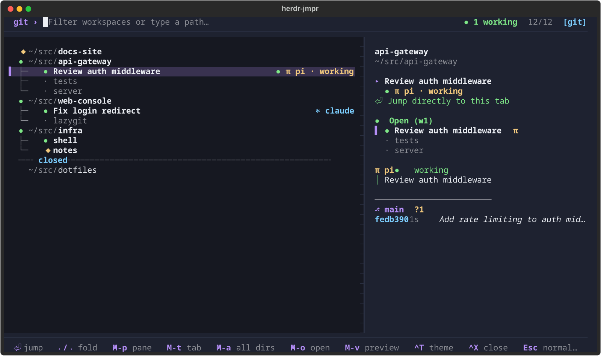
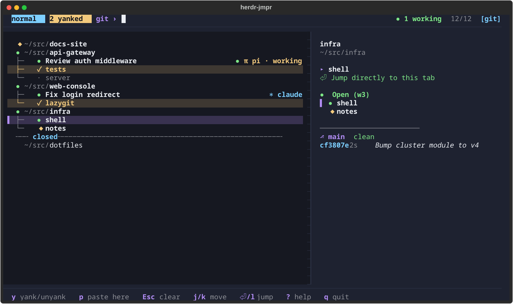

# herdr-jmpr

[](https://github.com/chmouel/herdr-jmpr/actions/workflows/ci.yml)
[](pyproject.toml)
[](https://herdr.dev)
[](https://docs.astral.sh/ruff/)
[](LICENSE)

Jump to project workspaces in [Herdr](https://herdr.dev), ranked by your `zsh-z`
or `zoxide` history.



The default picker is a Textual app. It has fzf-style search, vim keys, a preview
pane, and a tree of each open workspace's tabs with agent status. `fzf`, `skim`
(`sk`), and `gum` are available as alternatives.

| Search | Yank and paste tabs | Dracula theme |
| --- | --- | --- |
|  |  |  |

The screenshots come from `scripts/screenshots.py`, which uses demo repositories.

## Install

```sh
git clone https://github.com/chmouel/herdr-jmpr ~/git/perso/herdr-jmpr
cd ~/git/perso/herdr-jmpr
uv sync
herdr plugin link .
```

Needs Herdr 0.9.2 or later, `uv`, Python 3.10 or later, and `git` (the preview
pane reads repository status). The manifest runs `uv sync --frozen` on build and
startup, so the virtualenv stays current.

## Actions

| Action | Does |
| --- | --- |
| Jump to project workspace | Open the picker and jump to, or create, the workspace you pick |
| Move pane to project workspace | Move the focused pane there |
| Move tab to project workspace | Move the focused tab there, keeping its split layout |
| Jump to directory (all zsh-z / zoxide) | Pick from every history directory, not only git roots |

Each action opens in an 80% by 80% popup.

## Configuration

Config lives in `herdr plugin config-dir herdr-jmpr`, which defaults to
`~/.config/herdr/plugins/config/herdr-jmpr`.

### `names.tsv`: workspace labels

Labels default to the directory name. Override them with one line per path:

```tsv
# <path><TAB><label>
~/git/pac/main	PaC
~/git/pac/paco-cli	PaCo
```

A label applies to the directories below its path, and the closest path wins.
Any other malformed line prints `Invalid names.tsv line <n>` and exits 1.

### `config.toml`

Optional. The defaults work without it.

```toml
backend = "textual"     # textual | fzf | skim | gum | auto
theme = "auto"          # follows Herdr's theme, or any Textual theme name
start_mode = "insert"   # insert | normal
history = "auto"        # auto (zsh-z, then zoxide) | zshz | zoxide
show_tabs = true        # tab tree under open workspaces
```

Invalid keys or values print `Invalid <path>: ...` and exit 1.

Per run, override with flags or environment variables:

| Setting | Flag | Environment |
| --- | --- | --- |
| Backend | `--backend <name>` | `HERDR_JMPR_BACKEND` |
| Start mode | `--vim` / `--normal`, `--no-vim` / `--insert`, `--mode <mode>` | `HERDR_JMPR_START_MODE` |
| Tab tree | `--tabs` / `--no-tabs` | `HERDR_JMPR_SHOW_TABS` |

`HERDR_PLUGIN_CONFIG_DIR` points at another config directory.

## Picker

The Textual picker starts in insert mode, or normal mode with `start_mode =
"normal"`. It lists git repository roots. `alt+a` widens the list to every history
directory.

- Type to filter. Search uses fzf extended syntax: `foo | bar` is OR, `!term`
  negates, `^prefix` and `suffix$` anchor, `'exact` matches a substring. Smartcase
  applies.
- `enter` jumps. A typed existing path (`/…` or `~/…`) wins over the highlighted row.
- `◆` marks the current project, `●` marks open workspaces, and agent icons show
  what is running (`π` pi, `✻` Claude Code, and so on).
- `alt+e` (or `e` in normal mode) shows or hides the tab tree. Use `←`/`→` to fold
  a workspace.
- In normal mode, `y` marks tabs, `p` pastes them into the row under the cursor
  and jumps to the moved tab, and `Esc` clears the marks. With no marks, `p`
  moves the pane.

The full key list is in [docs/KEYS.md](docs/KEYS.md).

Other backends:

- `fzf` and `skim` use the same main bindings: `enter`, `alt-p`, `alt-t`, `alt-a`,
  `alt-o`, `ctrl-x`, and `ctrl-h`.
- `fzf`, `skim`, and `gum` also show the tab tree. Folding and yank/paste are
  Textual-only.

## How jumps resolve

1. A live workspace already mapped to the target directory.
2. An unmapped workspace with the same label that has a pane in the target.
3. Otherwise you choose between creating a workspace and reusing an unmapped one.
4. Otherwise a workspace is created.

Mapping changes run under an exclusive lock on the state file, and Herdr focus
commands run after it releases. Moves run after the picker exits, so a closing
popup can't interrupt them. Errors append to `<state dir>/last-error.log`.

## State

State lives in `${XDG_STATE_HOME:-~/.local/state}/herdr/plugins/state/herdr-jmpr`,
or `HERDR_PLUGIN_STATE_DIR`. Each Herdr socket has a `<sha256>.json` mapping file
and a `.lock` file.

The mapping is also published to the running server as a `jmpr_path` workspace
token, so other tools can read the project path and a fresh state file recovers
from the running server. The file is written first under the state lock, so it
always wins on conflict; a token only fills workspaces the file does not know.
Herdr caps token values at 80 characters, so a token at the cap may be
truncated and is ignored as an exact path. The startup hook republishes tokens after a restart, and a
`workspace.closed` hook prunes the file. Reads use one `herdr api snapshot`
round-trip, which keeps the picker consistent when workspaces change mid-flight.

## Development

See [DEVELOPMENT.md](DEVELOPMENT.md) for commands, the code layout, and the
screenshot script. Contribution notes are in [CONTRIBUTING.md](CONTRIBUTING.md).

## License

MIT. See [LICENSE](LICENSE).
