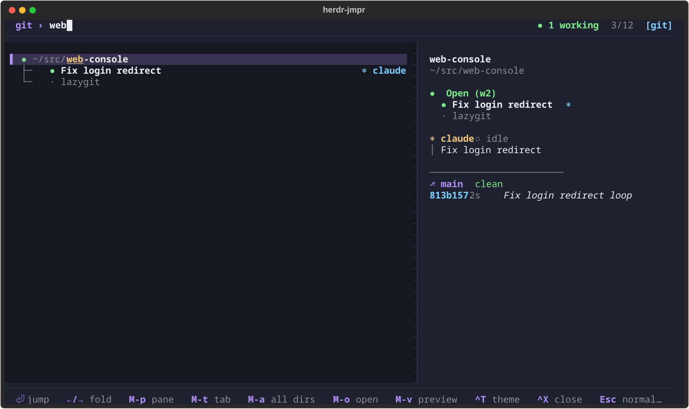
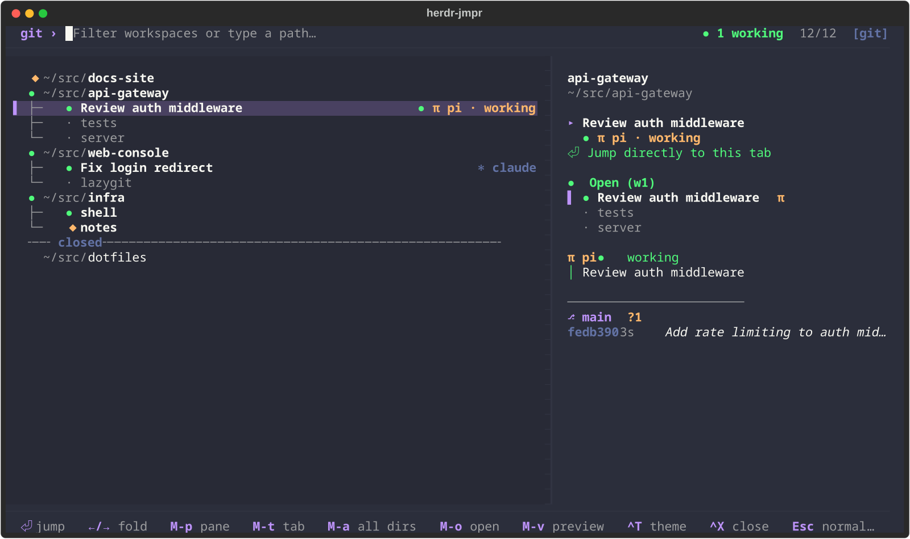

# herdr-jmpr

[](https://github.com/chmouel/herdr-jmpr/actions/workflows/ci.yml)
[](pyproject.toml)
[](https://herdr.dev)
[](https://docs.astral.sh/ruff/)
[](LICENSE)

Jump to project workspaces in [Herdr](https://herdr.dev), ranked by your `zsh-z`
history. The default picker is a Textual app with fzf-style search, vim normal
mode, a live preview, and a tree of each workspace's tabs with agent status.
`fzf`, `skim` (`sk`), and `gum` work as alternatives.


## Screenshots

| Search with highlighted matches | Vim normal mode with yanked tabs |
| --- | --- |
|  |  |

| Theme: Dracula |
| --- |
|  |

The images come from `scripts/screenshots.py`, which runs against demo
repositories, so no real paths show up in them.

## Install

```sh
git clone <this repository> ~/git/perso/herdr-jmpr
cd ~/git/perso/herdr-jmpr
uv sync
herdr plugin link .
```

The manifest runs `uv sync --frozen` as its build and startup hook, so the plugin
virtualenv is created and refreshed automatically. `bin/herdr-jmpr` uses
`<plugin_root>/.venv/bin/python` when it exists and falls back to
`uv run --project <plugin_root>` otherwise.

Requirements: Herdr 0.9.0 or later, `uv`, Python 3.10 or later, and `git`, which
the preview pane uses for repository status.

## Actions

| Action | What it does |
| --- | --- |
| Jump to project workspace… | Open the picker and jump to (or create) the workspace you pick |
| Move pane to project workspace… | Move the focused pane there instead |
| Move tab to project workspace… | Move the focused tab there, replaying its split layout |
| Jump to directory (all zsh-z)… | Pick from every zsh-z directory, not only git roots |

Each action opens the picker in an 80% by 80% popup.

## Configuration

Both files live in the plugin config directory. `herdr plugin config-dir herdr-jmpr`
prints it; by default it is `~/.config/herdr/plugins/config/herdr-jmpr`.

### Workspace labels (`names.tsv`)

Labels default to the directory name. To override them, create `names.tsv`:

```tsv
# <path><TAB><label>
~/git/pac/main	PaC
~/git/pac/paco-cli	PaCo
```

A label also applies to the directories below its path, and the closest path
wins. Empty lines and lines starting with `#` are ignored. Every other line needs
exactly one tab between a non-empty path and a non-empty label. Anything else
prints `Invalid names.tsv line <n>: <line>` and exits 1.

### Settings (`config.toml`)

Optional. Without it, the built-in defaults apply.

```toml
# Picker backend: "textual" (default), "fzf", "skim", "gum", or "auto".
# "auto" probes PATH in order: fzf -> sk -> gum -> textual.
backend = "textual"

# Textual theme: "auto" (default) follows Herdr's [theme].name and falls back to
# "herdr-ink". Any registered Textual theme works too, such as "dracula",
# "tokyo-night", "catppuccin-mocha", "rose-pine", "nord", or "gruvbox".
theme = "auto"

# Starting mode for the Textual picker. "insert" (default) filters as you type.
# "normal" starts in the vim keymap: j/k to move, i/a// to filter.
start_mode = "insert"

# History source: "auto" (default, zsh-z first, then zoxide), "zshz", or "zoxide".
history = "auto"

# Show open workspaces' tabs as a Unicode tree with agent badges and direct tab
# jumps. Toggle per run with --tabs / --no-tabs, or live with alt-e (e in normal mode).
show_tabs = true
```

Per invocation, `--backend <name>` (on `herdr-jmpr` and `herdr-jmpr open-picker`)
or `HERDR_JMPR_BACKEND` picks the backend. `--vim` or `--normal`, `--no-vim` or
`--insert`, and `--mode <insert|normal>` (`HERDR_JMPR_START_MODE`) pick the start
mode. `--tabs` and `--no-tabs` (`HERDR_JMPR_SHOW_TABS`) turn the tab tree on or off.

Unknown keys and invalid values print `Invalid <path>: ...` and exit 1 instead of
being ignored. `HERDR_PLUGIN_CONFIG_DIR` overrides the config directory, which is
handy for trying a different setup.

## Picker backends

- `textual` (default): the built-in switcher described below.
- `fzf`: a reverse layout in 16 colours. `Enter` jumps, `alt-p` moves the pane,
  `alt-t` moves the tab, `alt-a` toggles `git>` and `all>`, `alt-o` shows open
  workspaces only (`open>`), `ctrl-x` closes the selected workspace and reloads
  the live markers, and `ctrl-h` toggles the help drawer.
- `skim` (`sk`): the same `Enter`, `alt-p`, `alt-t`, `alt-a`, `alt-o`, `ctrl-x`,
  and `ctrl-h` bindings.
- `gum`: `gum filter` with frecency order kept and typed-path support.

## Textual picker

The picker starts in insert mode, or in normal mode when `start_mode = "normal"`.
It lists git repository roots. `alt+a` switches to every zsh-z directory.

Insert mode:

| Key | Action |
| --- | --- |
| typing | filter as you type (fzf extended search, smartcase) |
| `down`/`up`, `ctrl+n`/`ctrl+p`, `ctrl+j`/`ctrl+k` | move the selection |
| `page_down`/`page_up`, `ctrl+f`/`ctrl+b` | page |
| `ctrl+a`/`ctrl+e` | start / end of the query |
| `ctrl+u` | delete to start |
| `ctrl+w`, `alt+backspace` | delete the previous word or path segment |
| `ctrl+y` | yank |
| `ctrl+down`/`ctrl+up` | next / previous workspace, skipping tab rows |
| `left`/`right` | fold / unfold the selected workspace |
| `tab` | fill the query with the highlighted path |
| `escape` | normal mode |
| `ctrl+c`/`ctrl+g` | quit |

Normal mode:

| Key | Action |
| --- | --- |
| `j`/`k`/`down`/`up` | move the selection |
| `gg` / `G` | first / last item |
| `ctrl+d`/`ctrl+u` | half page |
| `ctrl+f`/`ctrl+b` | full page |
| `H`/`M`/`L` | top / middle / bottom of the viewport |
| `]` / `[` | next / previous workspace, skipping tab rows |
| `h` / `left`, `right`, `space` | fold, unfold, or toggle the workspace fold |
| `i`, `a`, `/` | insert mode |
| `dd` | clear the query |
| `C` | clear the query and enter insert mode |
| `y` | mark a tab (on a workspace row, mark all its tabs) |
| `p` | paste the marked tabs here; with nothing marked, move the pane |
| `escape` | clear the marks; with nothing marked, quit |
| `x` | close the project workspace |
| `o` | toggle open workspaces only |
| `e` | toggle the tab tree |
| `v` | toggle the preview |
| `T` | switch theme live |
| `t` | move the tab |
| `l`, `enter` | accept the selection |
| `?` | toggle help |
| `q` | quit |

Both modes: `enter` jumps. A typed `/` or `~` path wins over the highlighted row,
and so does the query itself when it is an existing directory and nothing else
matches. `alt+p` moves the pane, `alt+t` moves the tab, `alt+a` toggles the
`git` and `all` scope, `alt+o` toggles open workspaces only, `alt+e` toggles the
tab tree, `alt+v` toggles the preview, `ctrl+t` opens the live theme switcher,
and `ctrl+x` closes the project's workspace. Clicking selects a row, and
double-clicking jumps to it.

### Search

Search follows fzf `-e` extended syntax. Space-separated clauses are ANDed. `|`
separates alternatives inside a clause (`foo | bar baz`). Terms can be negated
(`!term`, `!^prefix`, `!suffix$`), anchored (`^prefix`, `suffix$`), or matched as
an exact substring (`'exact`). Smartcase applies: a term with an uppercase letter
matches case-sensitively. Rows keep their frecency order, and matches are
highlighted.

### Rows

The active row gets a `▌` pointer on a tinted highlight that keeps directory
paths, `[label]` tags, agent badges, and match underlines readable. `◆` marks the
current project, and `●` marks projects whose workspace is open. Agents show as
per-agent icons: `π` for pi, `✻` for Claude Code, and so on.

### Tabs

Open workspaces expand into a tree of their tabs. Each tab shows whether it is
focused (`◆`), active (`●`), or neither (`·`), plus any agent running in it. An
agent's status colours its badge: `working` is amber and `idle` is cyan. While the
tree is expanded, agent icons move from the workspace row to its tab rows.

Folded workspaces show their tab count (`▸ 3`) and their agent icons. Searching
matches tab titles and agent names, and a matching tab keeps its parent workspace
visible.

### Moving tabs

In normal mode, `y` marks a tab. On a workspace row, `y` marks all of its tabs.
Mark as many as you like, across any workspaces. Then `p` on any row moves the
marked tabs there and keeps their split layouts. If the target workspace is
closed, it is created. `Esc` clears the marks. With nothing marked, `p` moves the
focused pane, as before.

## How it decides where to go

1. A live workspace whose label is mapped to the target path is used.
2. Otherwise, an unmapped workspace with the same label and a pane in the target
   path is used, and its matching tab is focused.
3. Otherwise the picker asks whether to create a new workspace or reuse one of the
   unmapped workspaces with that label.
4. Otherwise a workspace is created with `herdr workspace create`.

The mapping update runs under an exclusive `flock` on the state lock file, and no
user interaction happens inside the lock. Focus commands run after the lock is
released. When the server restarts, saved mappings are checked against
`session.json` before they are kept.

Moves run only after the picker exits. Herdr calls get a closed `stdin` and
ignore `SIGHUP`, so a popup that closes when its tab empties cannot interrupt the
mapping or focus steps. Errors append to `<state dir>/last-error.log`.

## State

The state directory is `${XDG_STATE_HOME:-~/.local/state}/herdr/plugins/state/herdr-jmpr`,
or `HERDR_PLUGIN_STATE_DIR` when that is set. Each Herdr socket gets a
`<sha256(socket path)>.json` mapping file and a `.lock` file beside it.

## Development

See [DEVELOPMENT.md](DEVELOPMENT.md) for commands, screenshots, and the code layout.

## Contributing

See [CONTRIBUTING.md](CONTRIBUTING.md).

## License

MIT, see [LICENSE](LICENSE).
